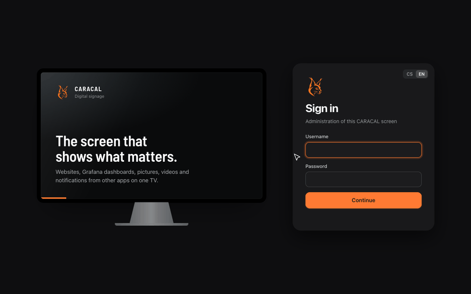

<p align="center">
  <picture>
    <source media="(prefers-color-scheme: dark)" srcset="docs/brand/hero-dark.svg">
    
  </picture>
</p>

<p align="center">
  Digital signage for Raspberry Pi 4/5 and PCs: a fullscreen player for web pages, Grafana dashboards, images,
  videos and IP cameras, with a web admin. Many screens are managed centrally with
  <a href="https://github.com/Gelluithor/Caracal-Fleet">CARACAL Fleet</a>.
</p>

<p align="center">
  <a href="https://github.com/Gelluithor/Caracal/releases/latest"></a>
  <a href="https://github.com/users/Gelluithor/packages/container/package/caracal-node"></a>
  
  <a href="LICENSE"></a>
</p>

<p align="center">
  <a href="https://gelluithor.github.io/caracal/">Website</a> ·
  <a href="#quick-start">Quick start</a> ·
  <a href="#small-boards-raspberry-pi-4-with-1-gb">Small boards</a> ·
  <a href="docs/NOTIFICATIONS.md">Notifications</a> ·
  <a href="#security">Security</a> ·
  <a href="https://github.com/Gelluithor/Caracal-Fleet">CARACAL Fleet</a>
</p>

<p align="center">
  
</p>

---

## How it fits together

```
 browser ──HTTP :8080──▶ CARACAL web admin (FastAPI, SQLite)
                              │ playlist, settings, notifications
                              ▼
 TV ◀──HDMI── Chromium player (fullscreen)  +  overlay (countdown bar, notifications)  +  mpv (cameras)
                              ▲
 Grafana, Alertmanager,  ─────┘ notification API (token)      watchers ──▶ Jira, GitLab, Zammad… (new items)
 Uptime Kuma, scripts

 optional: Fleet Agent ──local Fleet API──▶ the node, managed from CARACAL Fleet with many other screens
```

The device runs Docker and the X display; the web admin, the player and the overlay run in containers (or directly
on the system with the classic installation). Logins of websites are stored encrypted on the device only.

## Features

### Put anything on the screen

- **One playlist** of web pages, images, videos and IP cameras (RTSP, HTTP; ONVIF search, a grid of up to 9 streams
  played by mpv), in drag-and-drop order
- **Duration and zoom** per item, when adding, editing or live with a slider
- **Grafana collections:** all dashboards with a tag, read through Grafana's guest access on every cycle, so new
  dashboards show up by themselves
- **Websites behind a sign-in:** encrypted login profiles with automatic sign-in (log-in forms and HTTP
  Basic/Digest, the browser's pop-up), and automatic acceptance of common cookie banners
- **Dark mode** for the whole device or per item: the sites' own dark look, or forced dark for every page

### Control it live

- **Show or freeze** an item or a whole collection, skip to the next item, resume
- **Progress bar** at the bottom of the screen, a splash screen and a boot screen with the IP address
- **Restart** the player or the device from the admin UI

### Tell the room what's happening

- **On-screen notifications** from Grafana, Alertmanager, Uptime Kuma or your scripts through a token-protected API,
  shown one at a time from a queue, with your own look and sound per level
- **Watchers** that ask an app's API for new items: Zammad, Jira, Redmine, Freshdesk, GitLab, GitHub or any JSON API
- Details and examples in [docs/NOTIFICATIONS.md](docs/NOTIFICATIONS.md)

### Keep running

- **Fullscreen watchdog**, and a website that keeps the screen black for five minutes gets the player restarted
- **Small boards:** runs on a Raspberry Pi 4 with 1 GB (see [below](#small-boards-raspberry-pi-4-with-1-gb))
- **Czech and English** admin UI with dark mode and built-in help, in the same look as CARACAL Fleet

## Quick start

On Raspberry Pi OS Lite (64-bit), DietPi, Debian or Ubuntu (arm64, amd64), one command installs Docker, the X
display and the CARACAL containers:

```bash
curl -fsSL https://raw.githubusercontent.com/Gelluithor/Caracal/main/docker/install.sh | sudo bash
```

Open `http://<device-ip>:8080` and create the administrator. Options, updates and removal:
[docker/README.md](docker/README.md).

## Installation

### Docker (recommended)

The app, the player and the overlay run as containers from `ghcr.io/gelluithor/caracal-node` (arm64 and amd64).
The device only runs Docker, the X display and, optionally, the CARACAL Fleet Agent.

- **Without Fleet:** the one command above ([docker/install.sh](docker/install.sh)).
- **With CARACAL Fleet:** prepare an SD card in Fleet (zero-touch) or let Fleet install a Raspberry Pi over SSH.
  Fleet also updates the nodes and can create the administrator of the admin UI during the installation.
  A node installed without Fleet joins it later with *Add device → Fleet Agent only*.

### Classic installation (without Docker)

Installs CARACAL straight into the system (apt and systemd), on Raspberry Pi OS Lite or DietPi (Raspberry Pi 4/5):

```bash
git clone https://github.com/Gelluithor/Caracal.git
cd Caracal
sudo bash install.sh
```

Open `http://<device-ip>:8080` and create the administrator. Running `install.sh` again updates the application;
the data in `/var/lib/caracal` are kept. To remove CARACAL: `sudo bash uninstall.sh` (`--purge` also removes the
data). The Docker installation converts a classic one and keeps its data.

### Small boards (Raspberry Pi 4 with 1 GB)

CARACAL runs on a Raspberry Pi 4 with 1 GB of memory. On boards with up to 1.5 GB the player starts Chromium in its
low-end mode (fewer renderer processes, smaller caches, no background services) and restarts the browser between
two items when memory runs out; the countdown overlay draws at 30 frames per second. The installation (also the
one by CARACAL Fleet) turns on compressed swap in memory (zram) on boards with up to 2 GB. `CARACAL_LOW_MEMORY=1`
or `0` forces the mode on or off, `CARACAL_CHROMIUM_FLAGS` adds Chromium options, `CARACAL_OVERLAY_FPS` sets the
overlay frame rate. Very heavy dashboards still need memory: prefer fewer panels per dashboard on 1 GB boards.

## Data

Everything is stored in `/var/lib/caracal`: database, media, encrypted login profiles, player state and the
Chromium profile.

## CARACAL Fleet API

The CARACAL Fleet Agent talks to the node only through its local Fleet API (`/api/fleet/v1/*`, section
`CARACAL_FLEET_API_V2` in `app/main.py`). The API is protected by the key in `/etc/caracal-fleet-key` (classic) or
`/var/lib/caracal/.fleet-key` (Docker), which the agent writes when it is enrolled. Without the key the API answers
503 and exposes nothing. Everything the admin UI does is available through it as well, including the administrator
account (`POST /api/fleet/v1/admin`: created, or a new name and password that end its current sessions).

## Security

- The player playlist (`/api/player/playlist`, `/api/player/playlist-expanded`) is only served to the device
  itself, because it contains internal addresses.
- Sign-in to the admin UI is limited to 10 failed attempts per 5 minutes per address.
- Deleting an image or a video from the playlist also deletes its file.

## Releases

Raise the version in `VERSION` and push a tag `v<version>` (e.g. `v2026.10.07`). GitHub Actions builds the image
`ghcr.io/<owner>/caracal-node:<version>` and `:latest` for arm64 and amd64. Pushes to `main` build `:edge`.
CARACAL Fleet reads the available versions from the registry.

Nodes with the classic installation can also be updated from Fleet with a source archive of this repository
(*Download ZIP*), or converted to Docker.
